# Manual do Usuário — Biblioteca Viva

**Sistema:** [Biblioteca Viva](https://biblioteca-viva.duckdns.org/)  
**Deploy de produção:** https://biblioteca-viva.duckdns.org/  
**Equipe — Trilha B:**

- Raniery Chiarelli — RA 2840482321007
- Vinicius Rocha — RA 2840482523051
- Isaac Leonardo da Silva — RA 2840482421016
- Pedro Netto de Sousa Lima — RA 2840482323022

Este manual apresenta as funções disponíveis no Biblioteca Viva para cada perfil de acesso. As instruções e screenshots foram preparadas com base nas telas do sistema publicado.

> **Importante:** cada pessoa visualiza somente as opções correspondentes ao seu perfil. Os nomes das opções podem aparecer no menu superior. Para sair da conta, utilize **Sair**.

## 1. Acesso ao sistema

### Como entrar no Biblioteca Viva

1. Acesse [https://biblioteca-viva.duckdns.org/](https://biblioteca-viva.duckdns.org/).
2. Informe o e-mail cadastrado.
3. Informe sua senha.
4. Clique em **Sign In**.
5. Para encerrar o acesso, clique em **Sair**, no menu superior.

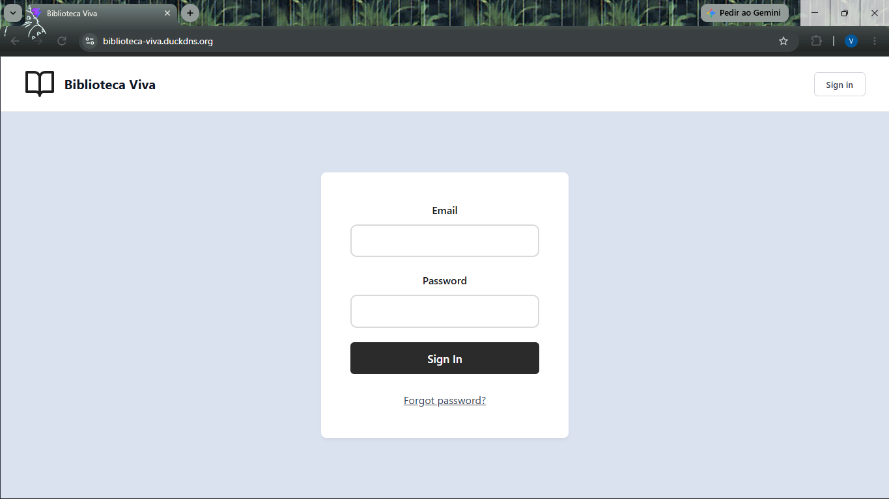

*Figura 1 — Tela de acesso ao sistema em produção.*

---

# 2. Para o perfil Leitor

O perfil Leitor permite consultar o acervo, acompanhar empréstimos e multas, visualizar sugestões de leitura, participar de clubes e consultar avisos.

## 2.1 Como consultar e pesquisar livros

1. Após entrar no sistema, acesse **Acervo**.
2. Na parte superior, confira as sugestões de leitura apresentadas.
3. Para localizar uma obra, utilize o campo de pesquisa.
4. Digite o título, o nome do autor ou uma categoria.
5. Confira a quantidade de exemplares disponíveis.
6. Clique em **Ver detalhes** para abrir as informações da obra.

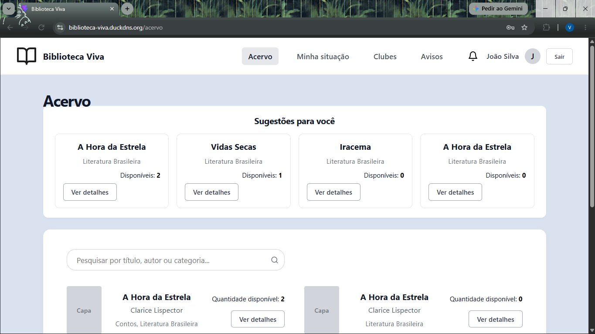

*Figura 2 — Acervo, sugestões e pesquisa de obras.*

## 2.2 Como consultar os detalhes de uma obra

1. Na tela **Acervo**, localize a obra desejada.
2. Clique em **Ver detalhes**.
3. Consulte o título, o autor, o tipo de livro, o ISBN e a descrição.
4. Confira a quantidade de exemplares disponíveis.
5. Quando houver exemplar disponível, siga a orientação apresentada pelo sistema para retirá-lo no balcão da biblioteca.

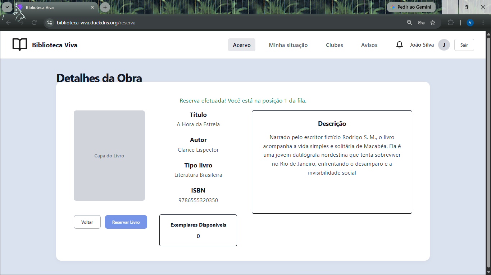

*Figura 3 — Informações detalhadas de uma obra.*

**Observação:** a tela de detalhes também apresenta a opção de reserva quando não há exemplares disponíveis. Este manual não apresenta o procedimento de solicitação de reserva pelo perfil Leitor. A situação de reservas já existentes pode ser acompanhada em **Minha situação**.

## 2.3 Como acompanhar empréstimos e consultar o histórico

1. Acesse **Minha situação**.
2. Na seção **Empréstimos**, localize o livro.
3. Confira a data de retirada e a data prevista para devolução.
4. Consulte a coluna **Situação** para verificar se o empréstimo está em dia ou atrasado.
5. Quando disponível, clique em **Histórico** para consultar os registros anteriores.

## 2.4 Como acompanhar reservas já realizadas

1. Acesse **Minha situação**.
2. Localize a seção **Reservas**.
3. Confira a obra, a situação da solicitação, a posição na fila e, quando houver, o prazo para retirada.

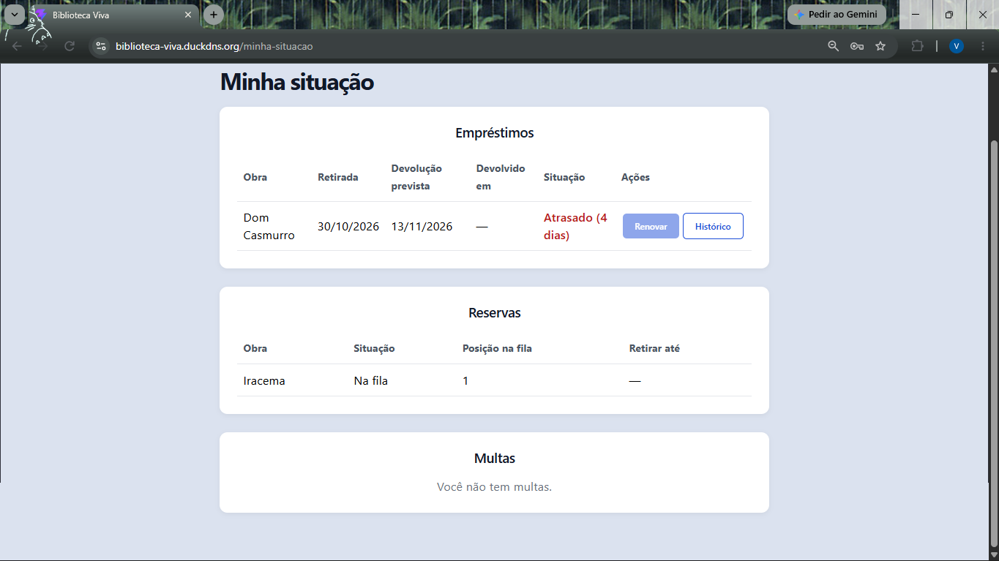

*Figura 4 — Acompanhamento de empréstimos, reservas e multas.*

## 2.5 Como consultar multas

1. Acesse **Minha situação**.
2. Role a página até a seção **Multas**.
3. Confira as informações apresentadas.
4. Se não houver multas, será exibida a mensagem **“Você não tem multas.”**

A área **Minha situação** reúne o acompanhamento dos empréstimos, das reservas e das multas do leitor.

## 2.6 Como localizar clubes de leitura e encontros

1. Acesse **Clubes**.
2. Para localizar um clube, utilize o campo **Buscar clube**.
3. Se desejar, selecione uma opção no filtro **Categoria**.
4. Consulte os clubes ativos, suas descrições, categorias, capacidade e periodicidade.
5. Na seção **Próximos encontros**, confira o nome do encontro, a data, o horário, o local ou link informado e a quantidade de vagas.
6. Em **Minhas inscrições**, consulte as participações confirmadas.
7. Utilize **Próximos** para visualizar as próximas participações e **Histórico** para consultar participações anteriores.
8. Se precisar cancelar uma participação, utilize **Cancelar inscrição** no encontro correspondente.

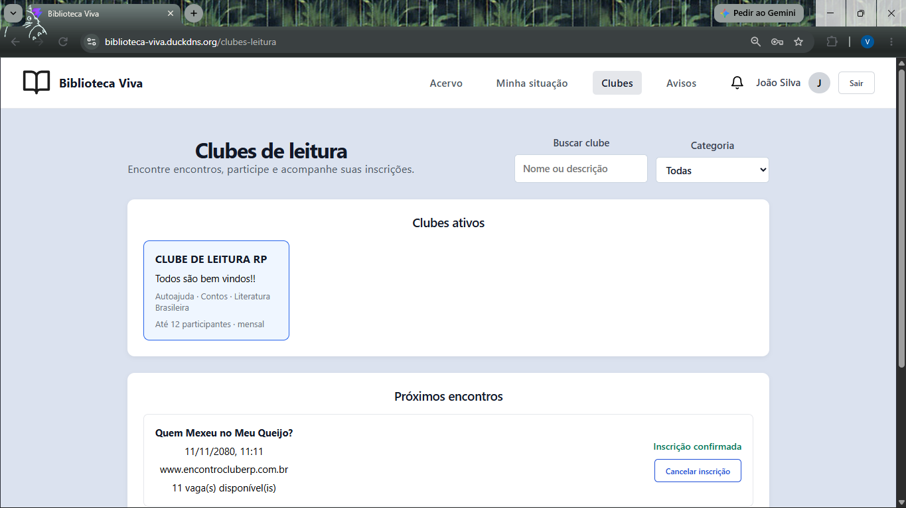

*Figura 5 — Clubes ativos, próximos encontros e inscrições do leitor.*

**Observação:** os cards dos clubes são informativos; a consulta de encontros e inscrições é feita pelas seções apresentadas na própria página.

## 2.7 Como consultar e marcar avisos como lidos

1. Acesse **Avisos**.
2. Utilize o campo **Mostrar** para escolher quais avisos deseja visualizar.
3. Consulte os avisos apresentados.
4. Para marcar todos como lidos, clique em **Marcar todos como lidos**.

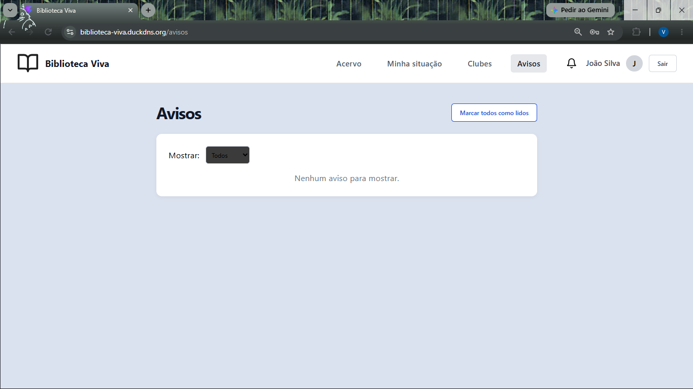

*Figura 6 — Área de avisos do leitor.*

---

# 3. Para o perfil Atendente

O perfil Atendente reúne as atividades de atendimento da biblioteca: cadastro e consulta de leitores, empréstimos, devoluções, renovações, clubes, fila de reservas e pendências.

## 3.1 Como consultar os leitores cadastrados

1. Acesse **Leitores**.
2. Consulte a relação apresentada.
3. Verifique nome, e-mail, documento, telefone e situação do cadastro.
4. Para iniciar um novo cadastro, utilize o botão de adicionar disponível na tela.

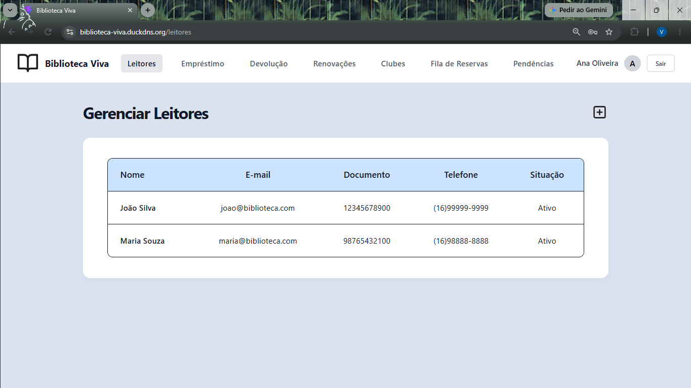

*Figura 7 — Relação de leitores cadastrados.*

## 3.2 Como registrar um empréstimo

1. Acesse **Empréstimo**.
2. No campo **Leitor**, digite o nome ou documento do leitor.
3. Selecione o leitor correspondente na busca.
4. No campo **Exemplar**, informe o identificador do exemplar.
5. Confira a data de retirada, preenchida automaticamente.
6. Confira a data prevista de devolução, definida pelo sistema.
7. Finalize em **Registrar Empréstimo**.

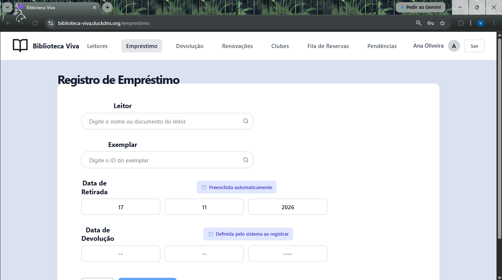

*Figura 8 — Formulário de registro de empréstimo.*

## 3.3 Como registrar uma devolução

1. Acesse **Devolução**.
2. No campo **Leitor**, informe o nome ou documento do leitor.
3. Selecione o leitor correspondente.
4. No campo **Exemplar**, selecione o exemplar emprestado.
5. Confira a data de retirada e a data de devolução.
6. Clique em **Registrar Devolução** para concluir.

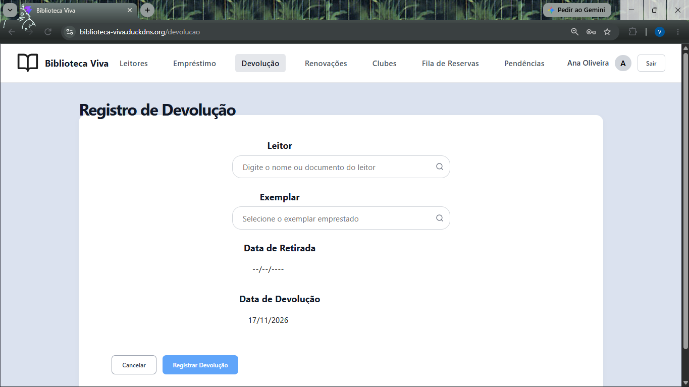

*Figura 9 — Formulário de registro de devolução.*

## 3.4 Como consultar e renovar empréstimos

1. Acesse **Renovações**.
2. Utilize o campo de busca para localizar o leitor, o empréstimo ou o exemplar.
3. Na lista de empréstimos ativos, confira as datas, a situação e os dados do exemplar.
4. Para consultar registros anteriores, clique em **Histórico**.
5. Quando a renovação estiver disponível, utilize **Renovar** na linha do empréstimo correspondente.

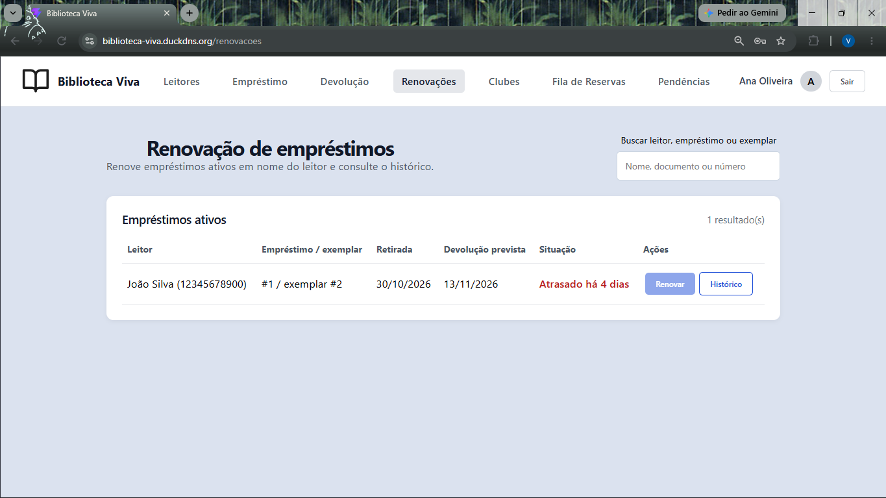

*Figura 10 — Consulta de empréstimos ativos, renovação e histórico.*

## 3.5 Como consultar a fila de reservas de uma obra

1. Acesse **Fila de Reservas**.
2. No campo **Obra**, digite o título, autor ou categoria.
3. Selecione a obra desejada.
4. Consulte a posição na fila, o leitor, a situação e as ações disponíveis para cada registro.

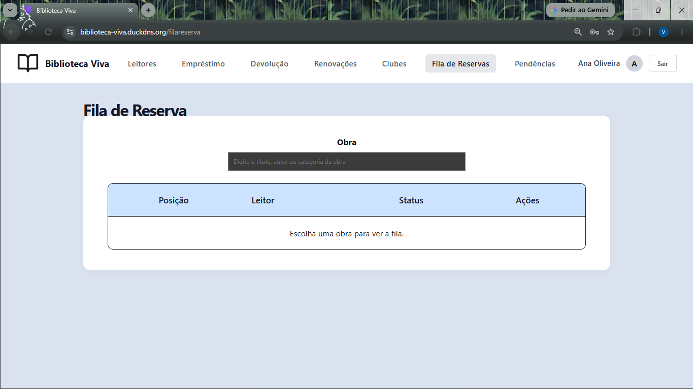

*Figura 11 — Consulta da fila de reservas por obra.*

## 3.6 Como acompanhar pendências do dia

1. Acesse **Pendências**.
2. Na seção **Empréstimos atrasados**, confira o leitor, a obra, a data prevista de devolução e os dias de atraso.
3. Na seção **Reservas com retirada vencendo**, confira o leitor, a obra e o prazo para retirada.
4. Para atualizar as informações exibidas, clique em **Atualizar**.

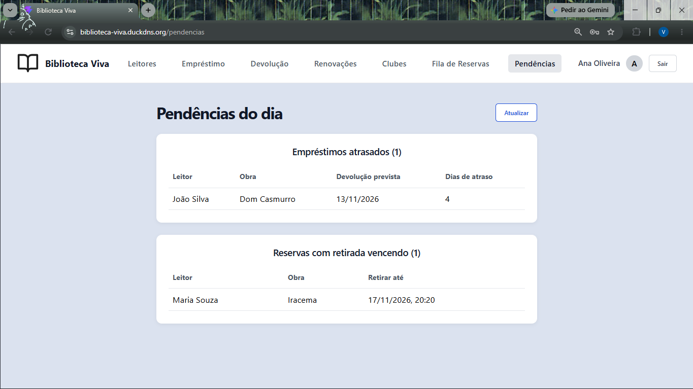

*Figura 12 — Empréstimos atrasados e reservas próximas do vencimento.*

## 3.7 Como consultar e organizar clubes e encontros

1. Acesse **Clubes**.
2. Consulte os clubes apresentados e sua situação.
3. Selecione o clube na própria área de gerenciamento.
4. Na seção de encontros, consulte a capacidade e os encontros associados.
5. Para agendar um encontro, informe a obra do acervo, a data e o horário e o local ou as instruções de acesso.
6. Preencha os demais campos solicitados e utilize a opção de confirmação apresentada na tela.

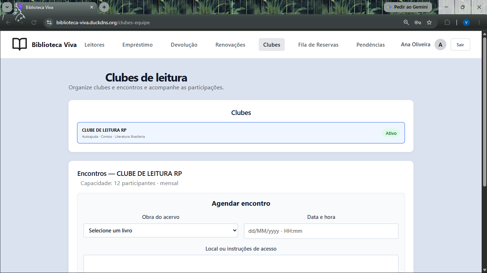

*Figura 13 — Área de clubes e organização de encontros pelo atendente.*

---

# 4. Para o perfil Administrador

O perfil Administrador reúne as funções de acompanhamento geral e gerenciamento dos usuários, livros, exemplares, renovações, clubes e avisos.

## 4.1 Como acompanhar os indicadores da biblioteca

1. Acesse **Dashboard**.
2. Consulte os cartões de empréstimos ativos, empréstimos atrasados, total de exemplares e total de livros.
3. Confira o gráfico de empréstimos por categoria.
4. Consulte a relação de livros mais emprestados.
5. Para exportar movimentações, informe opcionalmente as datas inicial e final.
6. Clique em **Baixar CSV**. Se deixar as datas em branco, o sistema permite exportar todos os períodos.

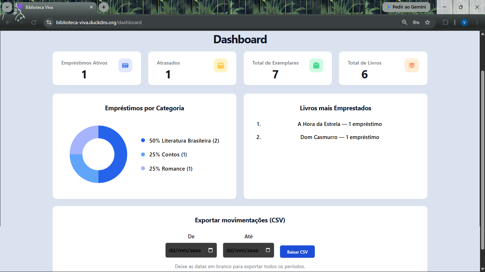

*Figura 14 — Indicadores, categorias, livros mais emprestados e exportação de movimentações.*

## 4.2 Como consultar e gerenciar usuários

1. Acesse **Usuários**.
2. Consulte nome, e-mail, perfil e situação de cada usuário.
3. Para cadastrar uma pessoa, utilize o botão de adicionar.
4. Preencha o nome completo, selecione o perfil, informe o e-mail e defina uma senha.
5. Clique em **Cadastrar**.
6. Para alterar um cadastro existente, utilize o ícone de edição na linha correspondente.
7. Para remover um cadastro, utilize o ícone de exclusão, quando a ação estiver disponível.

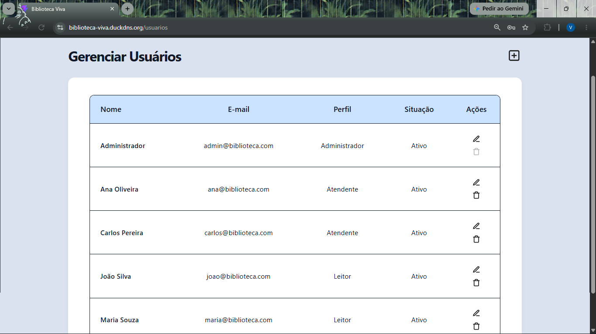

*Figura 15 — Lista de usuários, perfis e situação.*

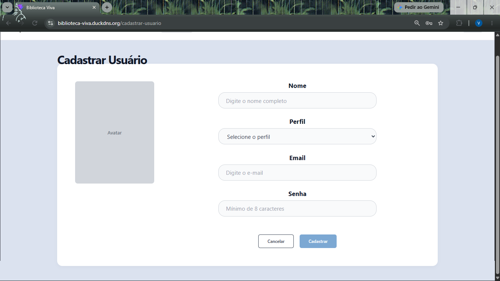

*Figura 16 — Formulário de cadastro de usuário.*

## 4.3 Como consultar e gerenciar livros

1. Acesse **Livros**.
2. Consulte a relação de obras, seus ISBNs, autores e categorias.
3. Para cadastrar uma obra, utilize o botão de adicionar.
4. Informe o título e o ISBN.
5. Se desejar, informe o ano de publicação e a descrição.
6. Selecione um ou mais autores e categorias disponíveis.
7. Para incluir um autor ou uma categoria que ainda não esteja na lista, utilize o campo correspondente e a opção **Adicionar**.
8. Conclua o cadastro pela opção apresentada no formulário.
9. Para alterar ou remover uma obra, utilize os ícones de ação na linha correspondente.

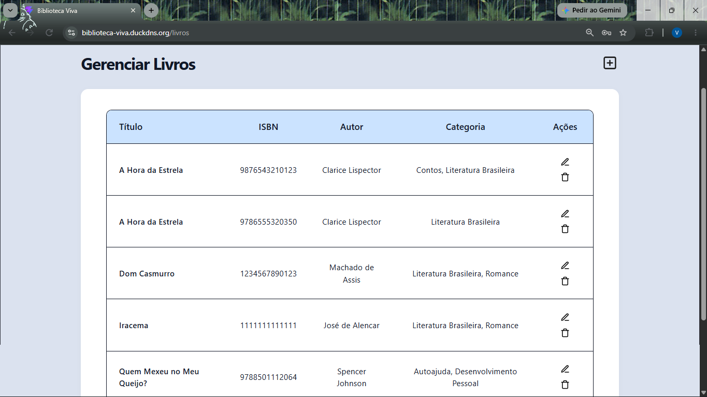

*Figura 17 — Relação de livros cadastrados.*

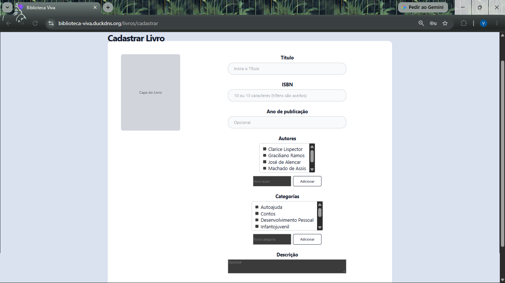

*Figura 18 — Formulário de cadastro de livro.*

## 4.4 Como cadastrar e gerenciar exemplares

1. Acesse **Exemplares**.
2. Para cadastrar um exemplar, utilize o botão de adicionar.
3. Selecione o livro ao qual o exemplar pertence.
4. Informe o código de tombo.
5. Selecione o estado de conservação.
6. Clique em **Cadastrar**.
7. Na lista, consulte o código, o título, o estado de conservação e a situação do exemplar.
8. Para editar ou remover um registro, utilize os ícones de ação correspondentes.

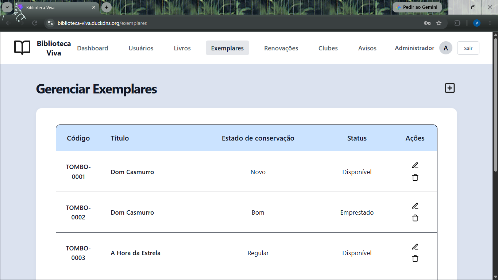

*Figura 19 — Relação de exemplares, conservação e situação.*

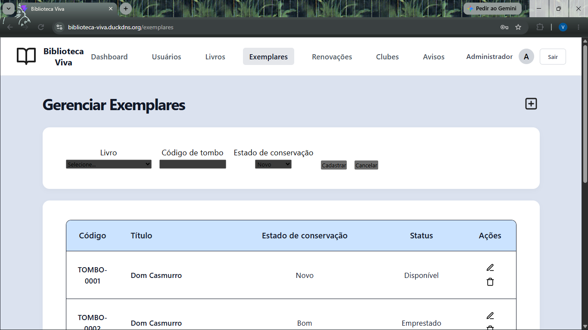

*Figura 20 — Formulário de cadastro de exemplar.*

## 4.5 Como consultar e renovar empréstimos

1. Acesse **Renovações**.
2. Pesquise pelo nome, documento ou número do empréstimo ou exemplar.
3. Consulte os empréstimos ativos e suas situações.
4. Quando a renovação estiver disponível, utilize **Renovar**.
5. Para consultar registros anteriores, clique em **Histórico**.

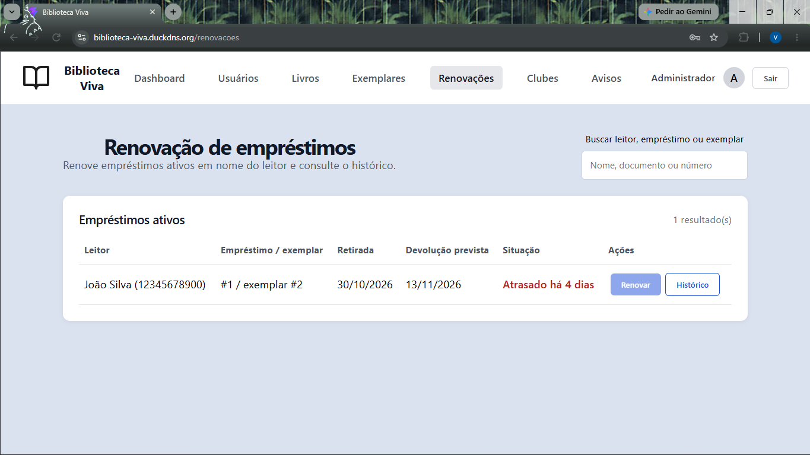

*Figura 21 — Consulta de empréstimos e renovações pelo administrador.*

## 4.6 Como criar e organizar clubes de leitura

1. Acesse **Clubes**.
2. Na área **Criar clube**, informe o nome e a descrição.
3. Defina a capacidade máxima de participantes.
4. Informe a periodicidade.
5. Selecione as categorias de interesse.
6. Clique em **Criar clube**.
7. Para organizar encontros, utilize a área de encontros do clube e preencha as informações solicitadas, como obra do acervo, data, horário e local ou instruções de acesso.

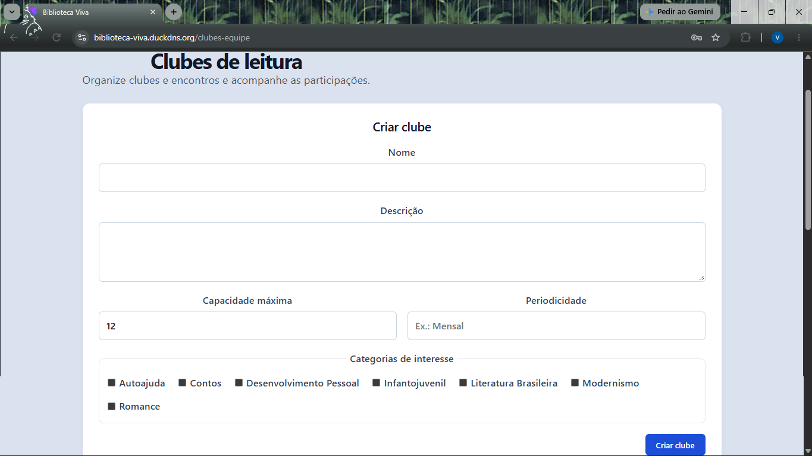

*Figura 22 — Formulário de criação de clube de leitura.*

## 4.7 Como configurar os avisos do sistema

1. Acesse **Avisos**.
2. Na área de configuração, confira os tipos de aviso disponíveis.
3. Marque os avisos que deseja manter ativos e desmarque os que não deseja gerar.
4. Clique em **Salvar preferências**.
5. Se precisar executar a verificação de avisos manualmente, utilize **Gerar avisos agora**.

Entre os tipos apresentados estão: devolução no dia seguinte, empréstimo vencido, reserva disponível, reserva próxima do vencimento, reserva expirada, multa gerada e mudança na posição da fila de reserva.

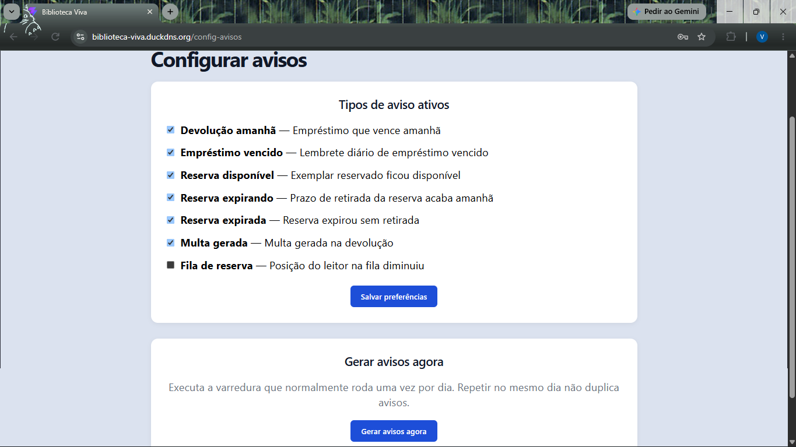

*Figura 23 — Configuração e geração de avisos.*

---

# 5. Perguntas frequentes e problemas comuns

**Não consigo entrar no sistema. O que devo fazer?**  
Confira se o e-mail e a senha foram digitados corretamente. Se não lembrar a senha, utilize **Forgot password?** na tela de acesso.

**Não encontro um livro no acervo.**  
Pesquise pelo título, autor ou categoria. Confira também a escrita dos termos utilizados.

**O livro aparece sem exemplares disponíveis. Posso retirá-lo?**  
Não. A tela de detalhes informa quando há exemplar disponível. Quando não houver, procure o atendimento da biblioteca para receber orientação.

**Como sei quando devo devolver um livro?**  
Acesse **Minha situação** e confira a data prevista de devolução na seção **Empréstimos**.

**O que significa um empréstimo atrasado?**  
Significa que a data prevista de devolução já passou e o empréstimo ainda não foi registrado como devolvido.

**Onde consulto minhas multas?**  
No perfil Leitor, acesse **Minha situação** e consulte a seção **Multas**.

**Onde vejo a posição de uma reserva?**  
Acesse **Minha situação** e consulte a seção **Reservas**.

**Como vejo os próximos encontros de um clube?**  
Acesse **Clubes** e consulte a seção **Próximos encontros**. Suas participações também aparecem em **Minhas inscrições**.

**Não aparece nenhum aviso para mim. Isso é um erro?**  
Não necessariamente. Quando não há avisos disponíveis, o sistema apresenta a mensagem **“Nenhum aviso para mostrar.”**

**O que fazer se uma opção não aparecer no menu?**  
As opções variam conforme o perfil de acesso. Se uma função necessária não estiver disponível, procure o responsável pela biblioteca ou o administrador do sistema.

**Como o atendente identifica empréstimos atrasados ou reservas próximas do vencimento?**  
Acesse **Pendências**, onde as duas situações são apresentadas em seções separadas.

**Como exportar as movimentações da biblioteca?**  
No perfil Administrador, acesse **Dashboard**, informe um período se desejar e clique em **Baixar CSV**. Sem datas, a exportação considera todos os períodos.

---

## 6. Encerramento

O Biblioteca Viva oferece áreas específicas para leitores, atendentes e administradores. Em caso de dúvida sobre uma operação ou sobre as informações exibidas, procure o responsável pela biblioteca.

**Endereço do sistema:** https://biblioteca-viva.duckdns.org/
