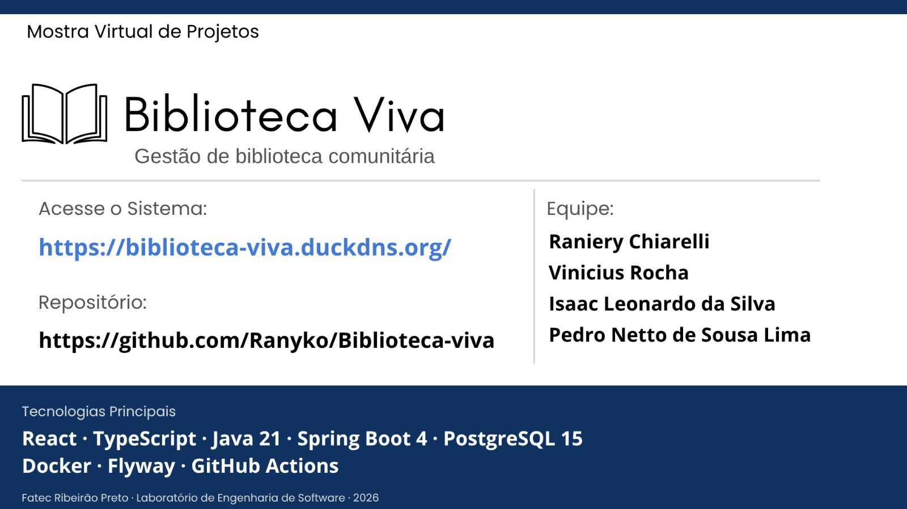
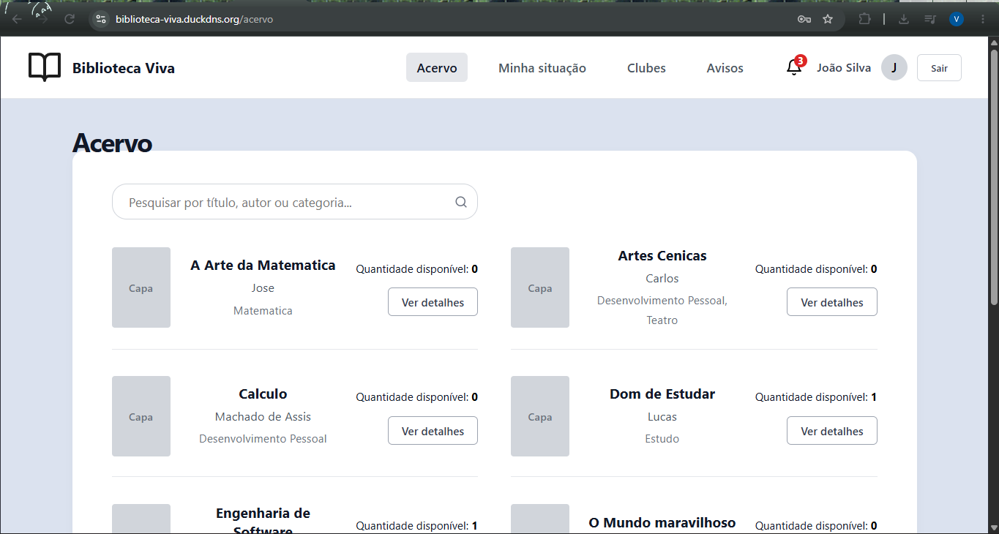
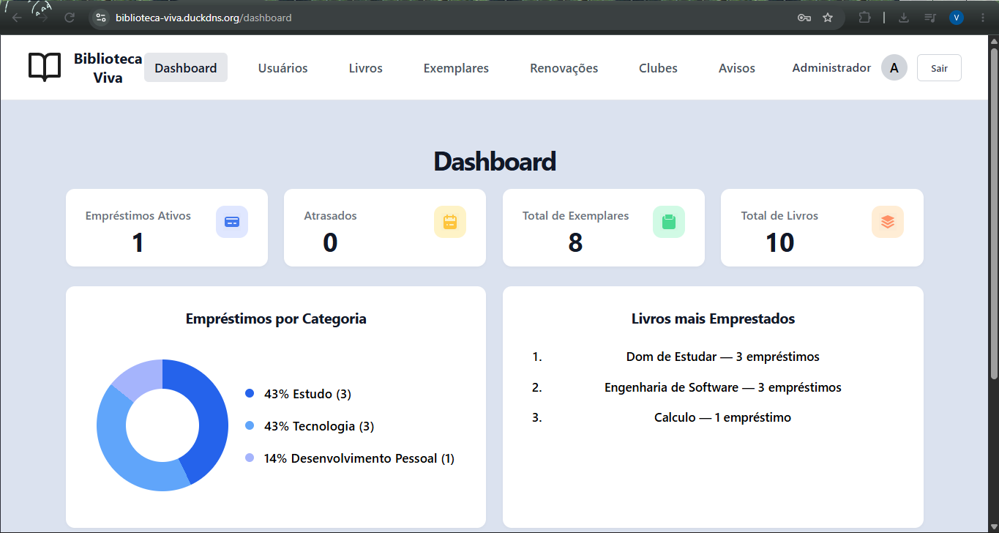
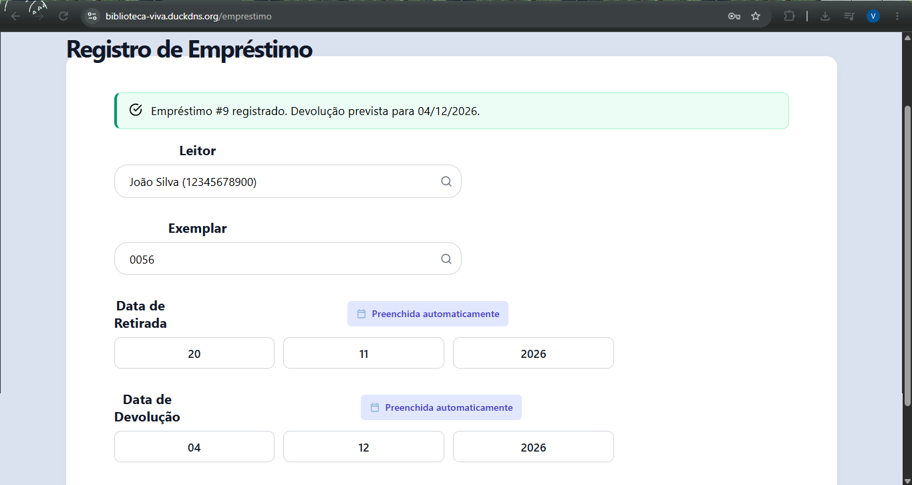

# Mostra Virtual — Biblioteca Viva

**Frase de destaque:** Gestão de biblioteca comunitária com catálogo, empréstimos, devoluções, reservas e controle de acesso por perfil.

**Resumo:** O Biblioteca Viva é um sistema web de gestão de biblioteca comunitária que reúne o gerenciamento de usuários e acervo, pesquisa de obras, empréstimos, devoluções, reservas com fila de espera, multas e painéis administrativos. A solução utiliza frontend React com TypeScript, API Java/Spring Boot e PostgreSQL, com autenticação JWT, persistência via JPA e migrações versionadas com Flyway. O sistema está disponível em implantação pública.

## Equipe

| Nome completo | RA | Papéis exercidos (Sprints 1–4) |
|---|---|---|
| Raniery Chiarelli | 2840482321007 | Sprint 1: backend/dados. Sprint 2: backend (H4–H8). Sprint 3: backend (H11/H13), testes e documentação. Sprint 4: integração e testes. |
| Vinicius Rocha | 2840482523051 | Sprint 1: organização do Trello. Sprint 2: Scrum Master e backend (H9/H10). Sprint 3: Scrum Master e backend (H14/H15). Sprint 4: Scrum Master e backend (H12/H16 e integração). |
| Isaac Leonardo da Silva | 2840482421016 | Sprint 1: frontend. Sprint 2: frontend e integração com a API. Sprint 3: frontend. Sprint 4: frontend e integração. |
| Pedro Netto de Sousa Lima | 2840482323022 | Sprints 1–2: não especificado. Sprint 3: backend e frontend. Sprint 4: integração entre backend e frontend e deploy. |

**Cliente / PO:** Lucas Baggio Figueira · **Trilha:** B

**Tecnologias:** Java 21, Spring Boot 4, Spring Security, Spring Data JPA, Spring Web MVC, React 19, TypeScript, React Router, Vite 8, PostgreSQL 15, Hibernate/JPA, Flyway, JWT, Docker Compose e GitHub Actions.

## Links

- Vídeo: https://drive.google.com/file/d/17FrspGXRbimYLnijmyRBUCkl2ESCN_2y/view?usp=sharing
- Deploy: https://biblioteca-viva.duckdns.org/
- Repositório: https://github.com/Ranyko/Biblioteca-viva

## Aprendizado da equipe

A principal lição foi que planejar e distribuir tarefas não garante, por si só, o alinhamento da equipe. A clareza das responsabilidades, a comunicação contínua e o acompanhamento das atividades são essenciais para evitar retrabalho, antecipar dificuldades de integração e adaptar o planejamento ao longo das sprints.

## Imagens

### Capturas de tela

